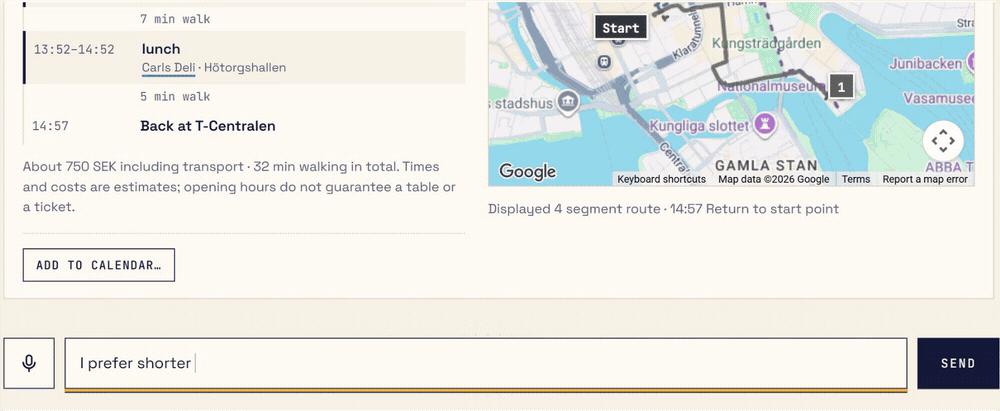
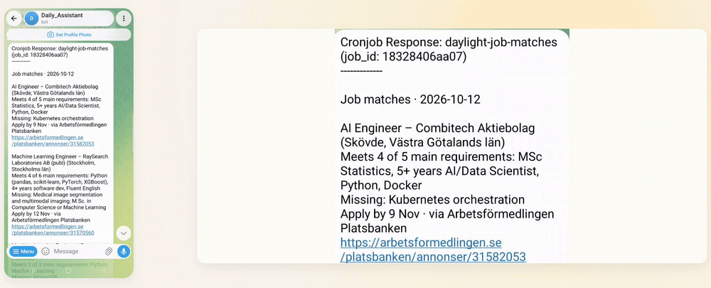
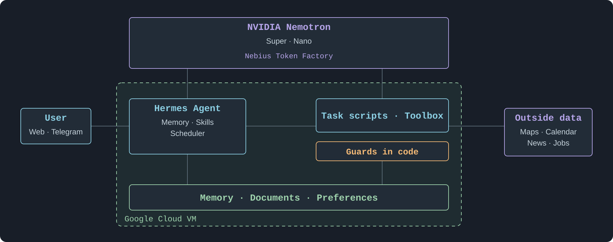

# Hora

A personal assistant that keeps working while you are away, and never acts on your behalf until you say yes.

**[Watch the demo · 2:34](https://youtu.be/JTYbxrvG53Y)**

**Live demo:** https://demo.34-51-186-249.sslip.io (user `judge`; the password is in the submission). You meet Maria Lind, a fictional data scientist.

> **Quick start** — Try one of the preset questions on the page, or ask Hora: **“What can you do?”** She will help you find a place to start.

Built on [Hermes Agent](https://github.com/NousResearch/hermes-agent), thinking with NVIDIA Nemotron on Nebius Token Factory. Reach her in Telegram, in a group chat, or on her own web page.

 

## What she does

### 🗺️ Day planning

Turn a museum visit, lunch and a movie into a few plans you can compare. Hora checks places, travel times and your calendar, and helps you choose a plan around your preferences, available time and budget.

### 🔎 Job watch

Keep looking without keeping a tab open. Hora checks new postings against your CV and preferences, then brings you suitable opportunities with what fits, what is missing and a link to apply.

### 💬 Group chat summaries

Catch up on what your group discussed: decisions, open questions and who will do what. Hora can then offer to add tasks to the shared to-do list or propose a meeting for your calendar.

## Features

**Always on.** Every few hours she checks new job postings against your CV and messages you only when one fits, with what fits and what is missing. Each morning she sends the new arXiv papers on your topics and the week's grocery offers. When nothing is new she stays silent, and no model is called.

**Persistent memory.** Say once that you avoid pork, or that you want remote data-science roles, and it holds from then on. Everything she knows is listed on her web page, where you can correct or remove it.

**Reusable skills.** Each ability is one tool, used everywhere: in a private chat, in a team group, on the web page and in scheduled jobs. In a group she summarises what people discussed, then offers to put its tasks on the shared to-do list and its meeting in your calendar.

**Your data, your say.** She runs on your own server and keeps her data in plain files there; what leaves it is the model calls to Nebius and the lookups listed below. Code, not the prompt, enforces the important lines:

- A calendar entry is written only after a separate, plain yes. In a group, only the owner's yes counts, and the owner's calendar is never read out.
- CV advice never suggests a skill the CV does not show: each requirement counts as met only if the quoted CV words are really in the CV.

## How it is built

What is ours: the tools in `mcp/`, the job scripts in `hermes/scripts/`, Hora's persona in `hermes/SOUL.daylight.md`, the web page in `public/`, and the guards in code. Hermes provides the agent loop, memory, chat connections and scheduler.

## Try it

Setup, deployment and tests: [SETUP.md](SETUP.md). What was checked against live services, and what was not: [VALIDATION.md](VALIDATION.md).

## Licence

MIT. See [LICENSE](LICENSE).
